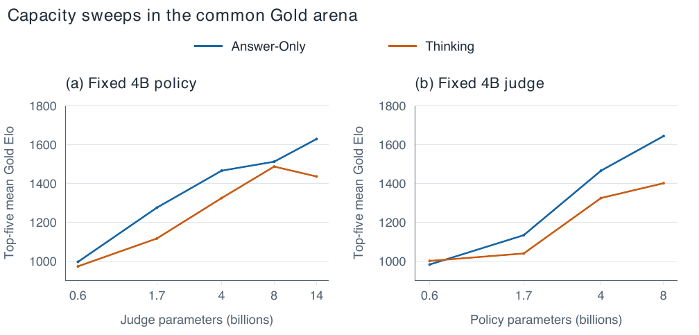
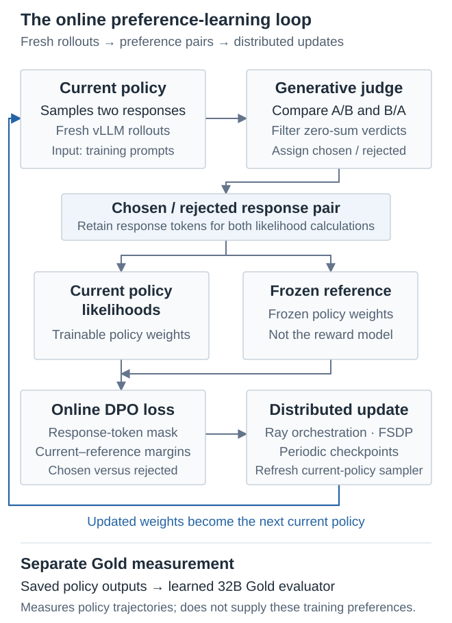

# Scaling Laws for Generative Reward Models

**Angel Raychev · Nathan Lile · Rafael Rafailov**

[Paper on arXiv](https://arxiv.org/abs/2610.30765) · [Research overview](https://angelraychev.com/scaling-laws-for-generative-reward-models/) · [Reproduce the figures](docs/reproduction.md)

Generative judges can evaluate a fixed collection of responses accurately yet
provide a weaker signal for improving a policy. This study connects judge
training, online policy optimization and evaluation under a separate learned
reference. It examines judge capacity, policy capacity, training duration,
regularization and the difference between evaluator accuracy and rewarder utility.

## Public release scope

**Updated 23 October 2026:** this repository distributes the paper, numerical
research artifacts and runnable CPU analysis. The custom training implementation
and historical training launchers are **not included in the current public
package**. An earlier package included them; the paper's original availability
paragraph reflects that earlier release scope. The learned weights and raw
story datasets are not redistributed here.

The source implementation is retained privately by SynthLabs. This repository
does not promise access on request, an upcoming source release, or a turnkey
replay of the training study. Its analysis tools are usable without private
code, model credentials or GPUs.

## What you can run

```sh
git clone https://github.com/RaychevAngel/generative-reward-models.git
cd generative-reward-models
uv sync --frozen
make verify test figures summary size-fits receipts
```

These commands verify the released numerical inputs, run artifact tests,
regenerate the supported figures, summarize matched settings, reproduce
descriptive size fits and recount retained comparison receipts. They perform
no model inference, training, judging, weight download or dataset export.
See [reproduction instructions](docs/reproduction.md) for outputs and boundaries.

| Material | Contents |
| --- | --- |
| [Paper](paper/) | The manuscript, bibliography and referenced figure assets. |
| [Results](results/) | Retained numerical tables, derived coordinates and text-free receipts. |
| [Analysis](analysis/) | CPU figure generation, descriptive summaries and verification. |
| [Analysis method source](docs/historical-source/) | Retained Elo/uncertainty analysis methods and their provenance. |
| [Earlier explorations](results/historical-explorations/) | Selected original chart exports with provenance and metric context. |
| [Prompt templates](paper/main.tex) | Policy-generation and pairwise-judge templates in Appendix C. |

## Main observations

- **Static judge accuracy does not determine downstream optimization quality.**
  Thinking judges trained with GRPO have stronger static Gold-label accuracy,
  while Answer-Only SFT rewarders achieve higher observed peak and top-five
  policy ratings in seven of eight matched settings under the learned Gold evaluator.
- **Reward-model capacity matters, including above policy size.** The sweeps
  study the effect of larger judges on policies they train, not just stand-alone
  preference prediction.
- **Checkpoint choice and training duration matter.** An intermediate judge
  checkpoint can be a better online rewarder than a later, more statically
  accurate checkpoint.



*Each point summarizes the five highest observed Gold ratings from its retained
trajectory. This is descriptive checkpoint selection, not held-out prospective
selection, an independent-seed average or a compute-optimal allocation rule.*

## The training system behind the study



Angel implemented the generative-judge Online DPO controller and paired actor
path in a fork of [verl](https://github.com/verl-project/verl), and conducted
the distributed training/evaluation program with his coauthors. The system
integrates current-policy generation, a separately configured generative judge,
both-order verdict aggregation and filtering, reference likelihoods, preference
batch assembly and distributed policy updates. Ray, FSDP and vLLM supply major
underlying execution components; DPO/IPO are established objectives.

The paper describes the method. The implementation is not part of this public
analysis package, and regenerating plots does not qualify its GPU execution.

## Interpreting the evidence

“Gold” denotes the study's learned 32B reference evaluator, not a human oracle.
The original source preferences are inferred from Reddit votes, not newly
collected explicit pairwise human annotations. Answer-Only and Thinking judge
pipelines differ in training objective as well as execution format; the study
does not isolate a causal effect of reasoning.

Ratings belong to evaluator-specific arenas. The released tables support
reproduction of retained analyses, not regeneration of all original model
outputs, every Elo fit, independent training seeds or all comparison rows.
Historical KL exports have preprocessing qualifications documented in the
[results guide](results/README.md). Three retained panels remain image-only;
we do not digitize their pixels into purported raw measurements.

## Citation

```bibtex
@misc{raychev2026scaling,
  title={Scaling Laws for Generative Reward Models},
  author={Angel Raychev and Nathan Lile and Rafael Rafailov},
  year={2026},
  eprint={2610.30765},
  archivePrefix={arXiv},
  primaryClass={cs.AI},
  url={https://arxiv.org/abs/2610.30765}
}
```

See [CITATION.cff](CITATION.cff), [release scope](docs/release-scope.md) and
[licenses and attribution](NOTICE). Code licensing does not relicense
third-party datasets or replace the manuscript's scholarly attribution.
