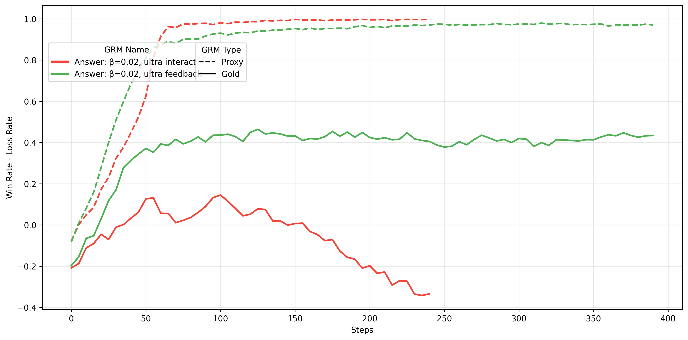
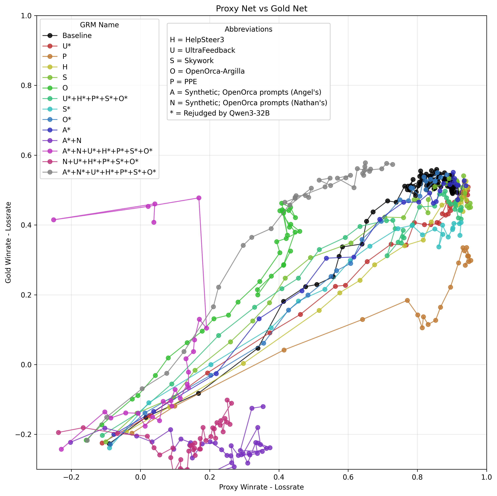
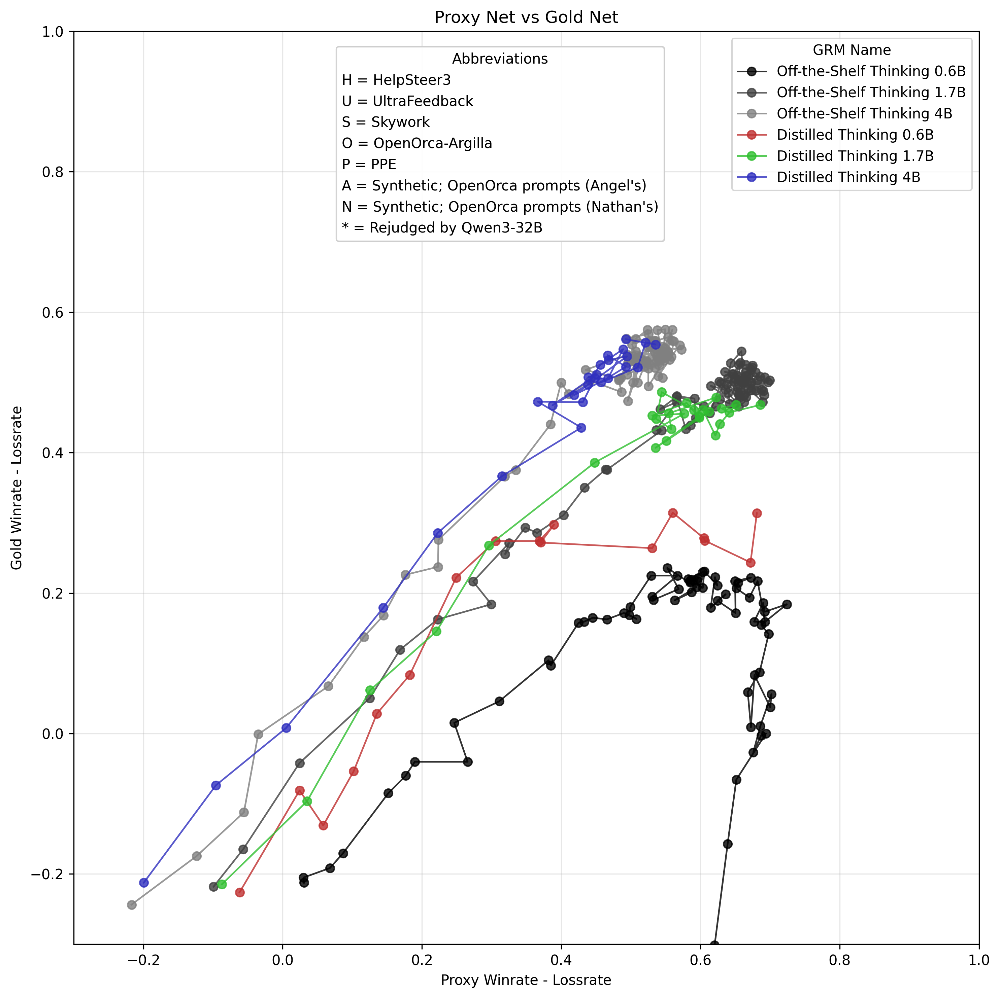

# Earlier exploratory reward-model experiments

These three original chart exports preserve parts of the broader experimental
program surrounding the paper's main matched-setting study. They show why data
recipes, reference-evaluator behavior and rewarder capacity were worth
investigating. They are not additional controlled replications of that study.

The vertical metric is **win rate minus loss rate**, not Elo. In the second
and third charts, the horizontal metric is the corresponding proxy net win
rate. The historical legends call their reference evaluator “Gold”; its exact
checkpoint has not been reconstructed for these exports. Do not pool these
curves with the paper's learned-Gold rating arena or infer that an identically
named evaluator is necessarily the same artifact.

Dates below are the recorded **artifact dates**, not verified training-start
or training-completion dates. The images are copied byte for byte, with no
digitized points, replotting or new runs. Source data and complete per-run
configurations are not supplied for these three charts. Their provenance is
limited to the original artifact IDs, dates and whole-file hashes in
[`manifest.json`](manifest.json).

## Data source: proxy saturation and reference divergence

**Artifact date: 17 August 2025.** The two displayed Answer-Only recipes are
labeled UltraInteract and UltraFeedback, both with beta 0.02. Dashed proxy
net-win-rate curves approach saturation, while the solid reference curves
do not track those gains. The UltraInteract reference curve eventually
declines; the UltraFeedback reference curve reaches a higher plateau in this
export. This is an observed proxy/reference divergence in these trajectories,
not a controlled general ranking of the datasets.

## Single-source and mixed-data recipes

**Artifact date: 3 September 2025.** Each trajectory relates proxy net win rate
to reference net win rate. The legend distinguishes single-source and mixed
recipes and marks some labels as rejudged. The grey mixed-recipe trajectory
reaches a higher reference peak than the black baseline in this image; many
other recipes do not, and some have low reference scores despite improved
proxy scores. The useful observation is recipe sensitivity, not a claim that
mixing or rejudging reliably improves a rewarder.

## Distillation across rewarder sizes

**Artifact date: 7 September 2025.** The displayed comparison covers 0.6B,
1.7B and 4B Thinking rewarders, each off the shelf or distilled. Distillation
improves the displayed 0.6B reference trajectory. It does not produce a
uniform improvement at the larger displayed sizes. These curves motivate
checking capacity and training recipe together; they do not establish a
general distillation gain or isolate a causal effect across matched runs.
